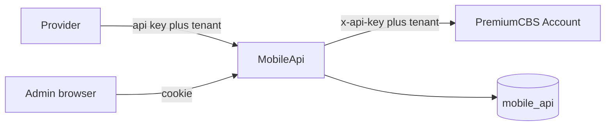

# MobileApi Rust rewrite

Add a new Axum service at [mobile-api/](mobile-api/) next to the .NET solution. Leave [ISmartConnect/](ISmartConnect/) in place until cutover. MobileApi owns a new Postgres database (`mobile_api`); it does not migrate the EF schema.

## Contract to keep

Callers still send the raw API key in `Authorization` and a `tenant` header that must match the client code. Unknown key is `401` with an empty body. Key/tenant mismatch is `400` with an empty body. Success JSON stays camelCase and still includes `isoResponseCode: "00"`, with the same trimmed fields the controllers return today (fund transfer returns `tranCode` only). Errors stay `{ "message", "errorCode": 500, "isoResponseCode" }` with HTTP 500. The ISO map in [ISmartConnect/Program.cs](ISmartConnect/Program.cs) (`51` insufficient funds, `39` EOD / day close / tran not allowed, `76` invalid account, `30` invalid transaction, `05` unable to process, `52` dormant, `54` closed, `62` restricted, `98` duplicate reversal, otherwise `96`) moves to a typed enum instead of matching exception text.

Public routes stay as they are in [DepositController.cs](ISmartConnect/Controllers/DepositController.cs), [LoanController.cs](ISmartConnect/Controllers/LoanController.cs), and [EchoController.cs](ISmartConnect/Controllers/EchoController.cs). PremiumCBS paths stay `api/mbank/...`, including `all-account-ismart/{memberId}`, which remains hidden behind `/api/deposit/all-account/{memberId}`. Another provider is a new `clients` row (its own key and tenant). PremiumCBS must already accept that tenant. A `/v1` prefix is not added in this pass.



## Stack and layout

Edition 2024, one crate. Axum 0.8 and Tower for HTTP. One shared `reqwest::Client` (rustls, connect and request timeouts) for CBS. SQLx for Postgres and migrations. Utoipa for OpenAPI at `/swagger`. Argon2 for admin passwords. Signed cookie via `axum-extra` (8-hour sliding session). Askama plus a vendored HTMX file for the admin UI, so the console works on a private network. Tracing for process logs.

```text
mobile-api/
  migrations/
  templates/          askama: layout, login, dashboard, logs, log detail, clients, users
  static/app.css
  static/htmx.min.js
  src/
    main.rs  config.rs  error.rs  state.rs
    auth/    cbs/account.rs
    routes/  logging/
```

Config comes from the environment: `DATABASE_URL`, `CBS_ACCOUNT_URL`, `CBS_API_KEY`, `ADMIN_USERNAME`, `ADMIN_PASSWORD`, `COOKIE_SECRET`. Startup fails if the CBS URL or key is missing. Those values are not copied out of [appsettings.json](ISmartConnect/appsettings.json) into the repo. [docker-compose.yml](docker-compose.yml) gains a `mobile_api` database on the existing Postgres service; the .NET connection string is unchanged.

API-key middleware is attached only to `/api`. The admin cookie is attached only to `/admin`.

## Logging

A Tower layer on `/api` buffers the inbound body (64 KB cap), calls the handler, then records one row. The CBS client returns status, duration, path, and body so the same row contains both hops. `Authorization` and `x-api-key` are redacted. Completed rows go through a bounded channel to one writer task that batch-inserts. Shutdown drains the channel. A full channel increments a counter and drops the log row; it never fails the banking call.

`request_logs` keeps the current columns from [RequestLog.cs](ISmartConnect/Entities/RequestLog.cs) and adds:

- `request_id`, `iso_response_code`
- `account_number`, `src_account`, `dest_account`, `member_id`, `tran_code`, `amount` parsed from the JSON at write time
- `upstream_path`, `upstream_status`, `upstream_duration_ms`, `upstream_body`
- `search_text` (path, error, account, tran code, member id) with a `pg_trgm` GIN index

Indexes: `requested_at DESC`, client, path, status, `is_error`, `iso_response_code`, `tran_code`, `account_number`. The free-text box searches `search_text`, not a `LIKE` over the 64 KB body. The table is partitioned by month on `requested_at`, with the current and next month created at startup.

## Admin UI

Server-rendered pages under `/admin`, styled in one stylesheet (sidebar, status pills, duration, dense table). HTMX swaps the log table and the detail pane so filters do not reload the whole page.

Log list filters, beyond [Logs/Index.cshtml](ISmartConnect/Views/Logs/Index.cshtml): time presets (15 minutes, 1 hour, today, 7 days) plus from/to, client, method, path, exact status and status class, ISO code, errors only, duration min/max, account, member id, tran code, and free text. Sort and page size stay. Each row shows time, client, method, path, status, ISO code, duration, and tran code or account.

Log detail replaces the three `<pre>` blocks in [Logs/Details.cshtml](ISmartConnect/Views/Logs/Details.cshtml): summary strip (time, client, status, ISO, request id), a two-step timeline (MobileApi, then PremiumCBS, each with status and duration), pretty-printed bodies with a raw toggle, headers as a table, copy-as-curl, and related rows (same tran code, or same account in a short window).

Dashboard keeps today's count, failures, success rate, average latency, per-client volume, top failing paths, recent errors, and the five-in-a-row alert from [DashboardController.cs](ISmartConnect/Controllers/DashboardController.cs). Add p95 latency and a failure count by ISO code.

Clients and users stay CRUD. A new client's API key is shown once; the database stores `SHA-256` of the key, and the in-memory map (`arc-swap`) is refreshed after create and edit. Admin users are seeded from `ADMIN_USERNAME` / `ADMIN_PASSWORD` on an empty database. Existing ASP.NET password hashes are not imported.

## Tests

Table-test the ISO map. Auth tests for a valid key, a bad key, and a tenant mismatch. One deposit route against Wiremock that checks the CBS headers and the trimmed JSON. One log-query test that a filter on account and ISO code hits the extracted columns.
